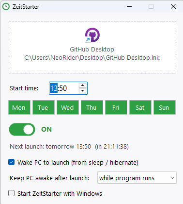

# ZeitStarter

A tiny Windows tool that launches a program (or shortcut) **on selected weekdays at a set time**. It can also **wake your PC from sleep or hibernate** to do it.

There is nothing to install and no dependencies: it's a single ~20 KB `.exe`.



## Features

- **Drag & drop.** Drop a program, shortcut (`.lnk`), `.bat` or `.url` onto the window, or click to browse.
- **Time and weekdays.** For example, only Mon–Fri at 07:30.
- **On/off switch.** Pause the schedule with one click.
- **Wake the PC.** It wakes the PC from sleep (S3) or hibernate 2 minutes before the start time, then launches the program.
- **Keeps the PC awake after launch**, either while the launched program is running or for a set time (15 min – 8 h). Without this, Windows sends a timer-woken PC straight back to sleep.
- **Runs in the tray.** The close button hides the window to the tray, and the schedule keeps running.
- **Optional start with Windows.**
- **Countdown** to the next launch, plus a "Launch now (test)" option in the tray menu.

## Download

Grab `ZeitStarter.exe` from **[Releases](../../releases)** and run it.

> **SmartScreen note:** The exe isn't code-signed, so on first launch Windows may show "Windows protected your PC". Click **More info → Run anyway**. If you'd rather not trust a prebuilt binary, build it yourself from source (see below). Release binaries are built by GitHub Actions straight from this repository and ship with a SHA-256 checksum.

## Requirements

- Windows 10 or 11 (the required .NET Framework 4.x is built in)

### Making wake-up work

1. Open *Control Panel → Power Options → Change plan settings → Change advanced power settings*.
2. Set **Sleep → Allow wake timers** to **Enable**. On laptops, set it for both battery and plugged in.
3. To verify, run `powercfg /waketimers` in an admin command prompt. ZeitStarter should be listed.

Limitations:
- Software can't power on a PC that is **fully shut down**. That needs BIOS/UEFI "RTC wake" or Wake-on-LAN.
- On devices with **Modern Standby (S0)**, waking can be unreliable.
- You need to be **signed in** to Windows. A locked screen is fine. After a reboot, ZeitStarter starts once you sign in.

## Build from source

The C# compiler ships with Windows:

```bat
build.bat
```

Or with Mono on Linux/macOS:

```sh
mcs -target:winexe -optimize -out:ZeitStarter.exe -r:System.Windows.Forms.dll -r:System.Drawing.dll ZeitStarter.cs
```

## Settings

Settings are stored in `%APPDATA%\ZeitStarter\settings.ini`.

"Start with Windows" adds an entry under `HKCU\Software\Microsoft\Windows\CurrentVersion\Run`. No admin rights are needed.

## License

MIT, see [LICENSE](LICENSE).
